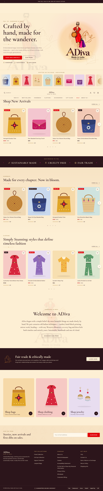
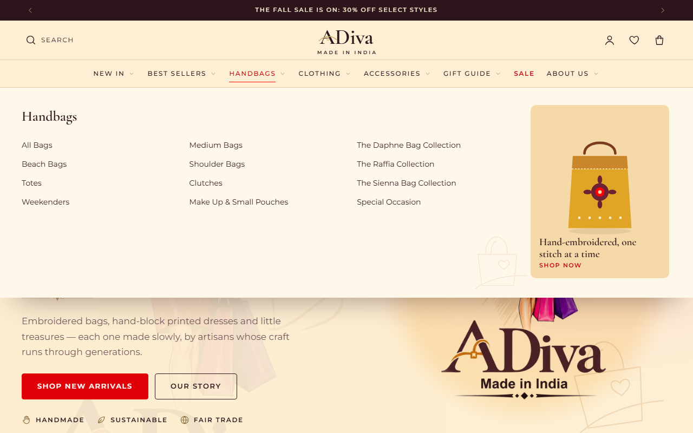
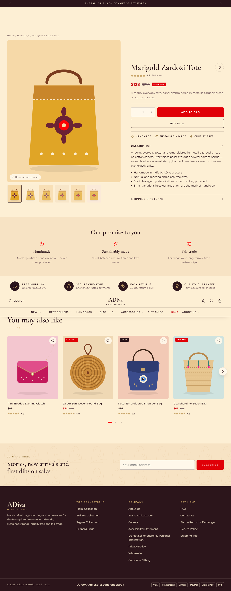
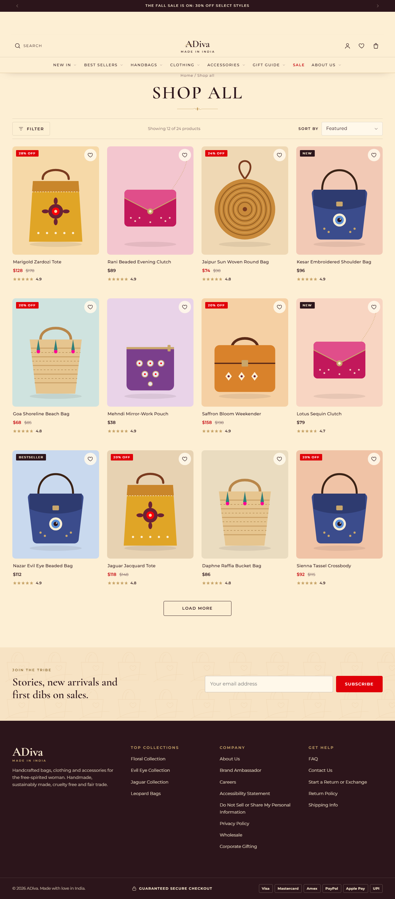
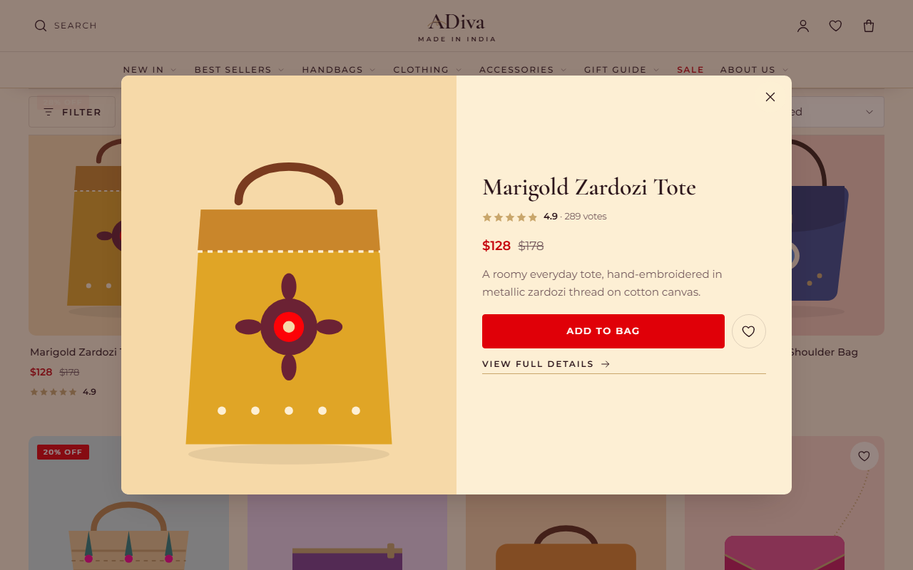
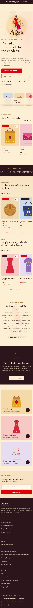

# ADiva — WordPress + WooCommerce Theme

A custom, builder-free WordPress theme for **ADiva**, a boho-luxe women's fashion brand of handcrafted bags, clothing and accessories, made in India.

It follows the shopping flow of a modern artisan fashion store: announcement bar, mega menu, a homepage built from product carousels and brand statements, collection pages with filters and Load More, and a full product page. It is styled in the ADiva palette, and the logo illustration appears as a faint watermark behind key sections.



---

## Contents

- [Highlights](#highlights)
- [Screenshots](#screenshots)
- [Quick start — local preview](#quick-start--local-preview-no-wordpress-needed)
- [Install on WordPress](#install-on-wordpress)
- [Customise](#customise)
- [Design system](#design-system)
- [Visual tests (Playwright)](#visual-tests-playwright)
- [Project structure](#project-structure)
- [Before launch](#before-launch)

---

## Highlights

| Area | What's included |
|---|---|
| **Header** | Rotating announcement bar; sticky header; centred wordmark; search overlay; account, wishlist and cart icons with live counts |
| **Navigation** | Mega menu on desktop (hover, click or keyboard; Esc closes); accordion menu in an off-canvas drawer below 1100px |
| **Homepage** | Hero, "As seen on" marquee, New Arrivals carousel, "Our promise to you" marquee, Bags and Clothing carousels, Welcome, Fair Trade, Shop tiles |
| **Carousels** | Native scroll-snap (touch swipe), arrows, pagination dots, keyboard arrow keys |
| **Collections** | Filter drawer (category and price), 8 sort options, responsive 2/3/4-column grid, Load More over real pagination, Recently Viewed |
| **Product page** | Gallery with hover/tap zoom and thumbnails, wishlist, rating, sale and regular price, size swatches, quantity stepper, **Add to Bag** and **Buy Now** (goes straight to checkout), Description / Shipping / Reviews accordions, promise strip, trust badges, You May Also Like |
| **Quick View** | Modal opened from any product card; adds simple products to the cart over AJAX |
| **Wishlist** | Built in and stored in the browser, so no account is needed. Uses YITH WooCommerce Wishlist automatically if it is active |
| **Cart** | Mini-cart drawer kept in sync by WooCommerce cart fragments |
| **Newsletter** | Footer sign-up with nonce and honeypot; CSV export; `adiva_newsletter_signup` hook for Klaviyo, Mailchimp and similar |
| **One-click setup** | *Appearance → ADiva Setup* creates pages, product categories and menus, and sets the front page |
| **Quality** | No horizontal overflow at any tested width; WCAG-minded contrast, ARIA, focus trapping and reduced-motion support; no JS dependencies; lazy-loaded images |

---

## Screenshots

| Mega menu | Product page |
|---|---|
|  |  |

| Collection | Quick View | Mobile |
|---|---|---|
|  |  |  |

---

## Quick start — local preview (no WordPress needed)

The `dev-preview/` folder holds a small WordPress function shim. With it, PHP's built-in server renders the theme's own templates using a demo catalogue, so you can see and test the design without installing WordPress.

**Requires:** PHP 8.0+

```bash
git clone https://github.com/Vishad-N/Adiva_wp.git
cd Adiva_wp
php -S 127.0.0.1:8089 -t . dev-preview/router.php
```

Then open <http://127.0.0.1:8089/>. Pages to try:

| URL | Template |
|---|---|
| `/` | Homepage |
| `/shop/`, `/product-category/handbags/` | Collection pages |
| `/product/marigold-zardozi-tote/` | Product page |
| `/about-us/`, `/behind-the-product/`, `/sustainability/` | Brand story pages |
| `/wishlist/` | Wishlist |
| `/?s=clutch` | Search |

> Cart and checkout show placeholder text in the preview, because they need WooCommerce.
> The shim only runs under PHP's CLI server and returns 404 if requested from a real web server.

---

## Install on WordPress

**Requires:** WordPress 6.3+, PHP 8.0+, WooCommerce 8+

1. Copy this repository into `wp-content/themes/adiva/`, or zip it and upload it under **Appearance → Themes → Add New → Upload**.
   `dev-preview/`, `playwright/`, `docs/` and `package.json` aren't needed in production.
2. Activate **ADiva** under **Appearance → Themes**.
3. Install and activate **WooCommerce**, then run its setup wizard so the Shop, Cart, Checkout and My Account pages exist.
4. Open **Appearance → ADiva Setup** and click **Run setup**. Every step is idempotent. It:
   - creates the starter pages (About Us, Our Story, Sustainability, Behind the Product, FAQ, Shipping Info, Return Policy, Privacy, Terms, Contact, Wholesale, Corporate Gifting, Careers, Accessibility, Data Privacy Opt-Out, Gift Guide, Wishlist)
   - creates every product category from the menu hierarchy
   - builds the Primary mega menu and three footer menus, and assigns them
   - creates a Home page and sets it as the front page
5. Add your products. The demo catalogue shows until the store has at least one published product, then disappears.
   To turn it off earlier: `add_filter( 'adiva_use_demo_products', '__return_false' );`

> **Tip:** [LocalWP](https://localwp.com/) is the quickest way to run WordPress and WooCommerce locally on Windows or macOS.

---

## Customise

**Appearance → Customize → ADiva Theme**

| Section | Settings |
|---|---|
| Announcement Bar | Show or hide; one message per line, with an optional link after a pipe (`TEXT\|/url/`). Two or more lines rotate automatically |
| Homepage | Hero eyebrow, title and text; "As seen on" names; the three carousels' titles and category slugs; Welcome and Fair Trade text |
| Shipping & Trust | Free-shipping threshold, product-page shipping and returns text, returns address |
| Brand & Social | Primary accent colour; Instagram, Facebook, Pinterest and YouTube links |

- **Logo:** upload one under *Site Identity* to replace the built-in "ADiva" wordmark.
- **Menus:** edit *Appearance → Menus → ADiva Primary*. Each top-level item's *Description* becomes its mega-menu feature-card caption.
- **Hooks and filters:**

| Hook | Purpose |
|---|---|
| `adiva_use_demo_products` | Turn the demo catalogue on or off |
| `adiva_products_per_page` | Products per collection page (default 12) |
| `adiva_fonts_url` | Font stylesheet URL (return `''` to self-host) |
| `adiva_menu_tree` | Modify the normalised mega-menu tree |
| `adiva_newsletter_signup` | Action fired with each newsletter email |

---

## Design system

| Token | Hex | Use |
|---|---|---|
| Cream | `#FDEFD4` | Page canvas |
| Cream 2 / 3 | `#FCEED3` / `#F7E3C4` | Alternate sections, cards |
| Burgundy | `#2C151B` / `#31181C` | Text, headings, footer |
| Brand red | `#FD0207` | Large accents, highlights |
| Button red | `#E00008` | Primary buttons (5:1 with white) |
| Red text | `#C4000A` | Sale prices, links (5.3:1 on cream) |
| Pink | `#FC0393` | Hover states, details |
| Gold | `#C9A66B` | Flourishes, icons, dividers |

- **Type:** Cormorant Garamond for headings and Montserrat for UI and body text. Montserrat is the free alternative to Gotham named in the brief.
- **Brand art:** the logo illustration is a low-opacity watermark on the hero, the Welcome section and the story pages. The line-drawn shopping bag is used as a pattern and corner art, and gold flourishes serve as section dividers.

---

## Visual tests (Playwright)

```bash
npm install
npx playwright install chromium
npm run test:visual
```

The config starts the local preview automatically. Tests cover the **homepage, shop and a product page** at **375, 768, 1280, 1440 and 1920px**, and check that:

- there is no horizontal overflow (`scrollWidth <= innerWidth`)
- the header, footer, carousels, product cards and key elements are visible
- carousels and grids stay inside the viewport
- buttons, badges and nav links don't overflow their boxes
- there are no JavaScript errors

Interaction tests cover the mega menu (including at a tight 1100px), the mobile drawer, Quick View, carousel arrows, Load More, the wishlist, and filters and sorting. Full-page screenshots are saved to `playwright/screenshots/`.

To test a real WordPress site instead of the preview:

```bash
ADIVA_BASE_URL=https://staging.example.com \
ADIVA_PRODUCT_PATH=/product/your-product/ \
npx playwright test -c playwright
```

To reuse a Chromium that is already installed, set `PW_CHROMIUM_PATH=/path/to/chrome`.

---

## Project structure

```
.
├── style.css, functions.php            Theme header + bootstrap
├── header.php, footer.php              Chrome, drawers, Quick View dialog
├── front-page.php                      Homepage section flow
├── page.php, single.php, index.php, archive.php, search.php, 404.php, searchform.php, comments.php
├── page-templates/                     Brand Story, Wishlist
├── woocommerce/                        archive-product, single-product, content-product
├── template-parts/
│   ├── header/                         Announcement bar
│   ├── home/                           Hero, marquees, Welcome, Fair Trade, Shop tiles
│   ├── product/                        Card, carousel, trust badges, recently viewed
│   └── global/                         Overlays, post card
├── inc/
│   ├── setup.php                       Supports, menus, image sizes, assets
│   ├── menus.php                       Mega menu + default hierarchy, footer columns
│   ├── products.php                    Normalised product layer (WooCommerce or demo)
│   ├── demo-data.php                   Demo catalogue
│   ├── woocommerce.php                 Sorting, Buy Now, cart fragments
│   ├── customizer.php                  Customizer settings
│   ├── newsletter.php                  Footer sign-up handler
│   ├── setup-content.php               Starter page copy
│   └── admin-setup.php                 Appearance → ADiva Setup
├── assets/
│   ├── css/                            main.css, woocommerce.css, editor.css
│   ├── js/main.js                      All interactions (no dependencies)
│   └── images/                         Logo illustration, bag outline, demo art
├── dev-preview/                        Local preview shim (development only)
├── playwright/                         Config + visual/overflow tests
└── docs/screenshots/                   README images
```

---

## Before launch

- **Policy pages** are starter text marked as drafts. Have them checked against your actual terms and the laws that apply to you.
- **"As seen on"** is empty by default, and the strip shows product images instead. Only add publications that have actually featured ADiva.
- **Collection names** such as "Mahjong" and "Make Lemonade" are placeholders taken from the reference structure. Rename them to ADiva's own collections.
- **Ratings** only appear for products with real WooCommerce reviews. Demo ratings exist only in the demo catalogue.
- **Fonts** load from Google Fonts. To self-host, filter `adiva_fonts_url` to `''` and add your own `@font-face` rules.

---

## License

GPL-2.0-or-later, like WordPress itself. The ADiva name, logo and illustration are brand assets and are not covered by the code license.
